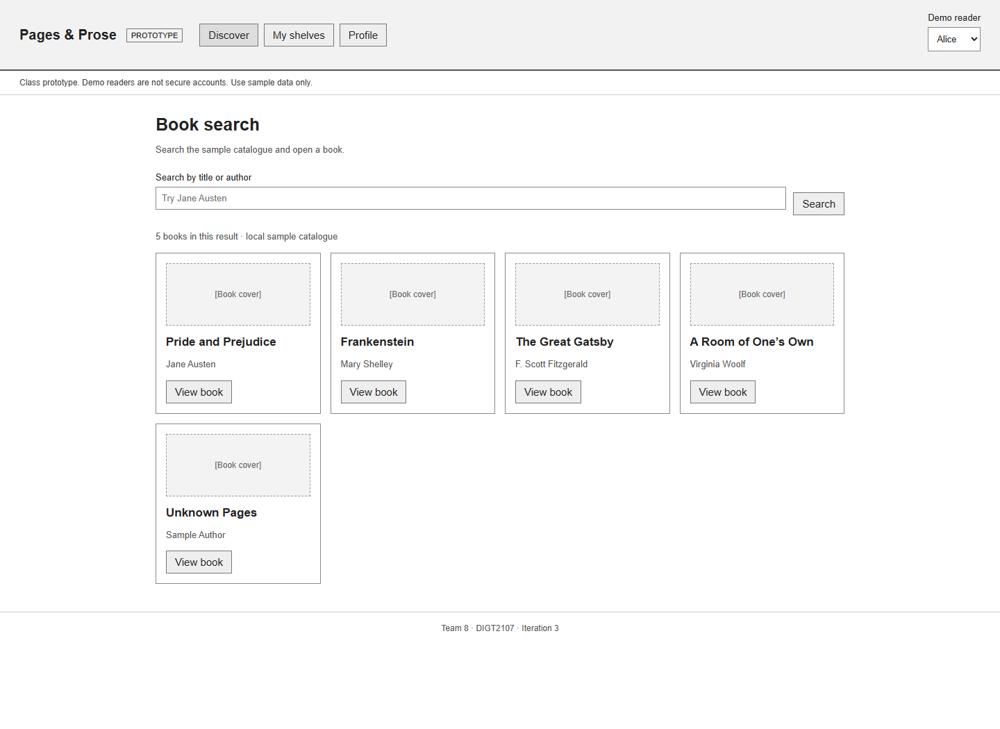
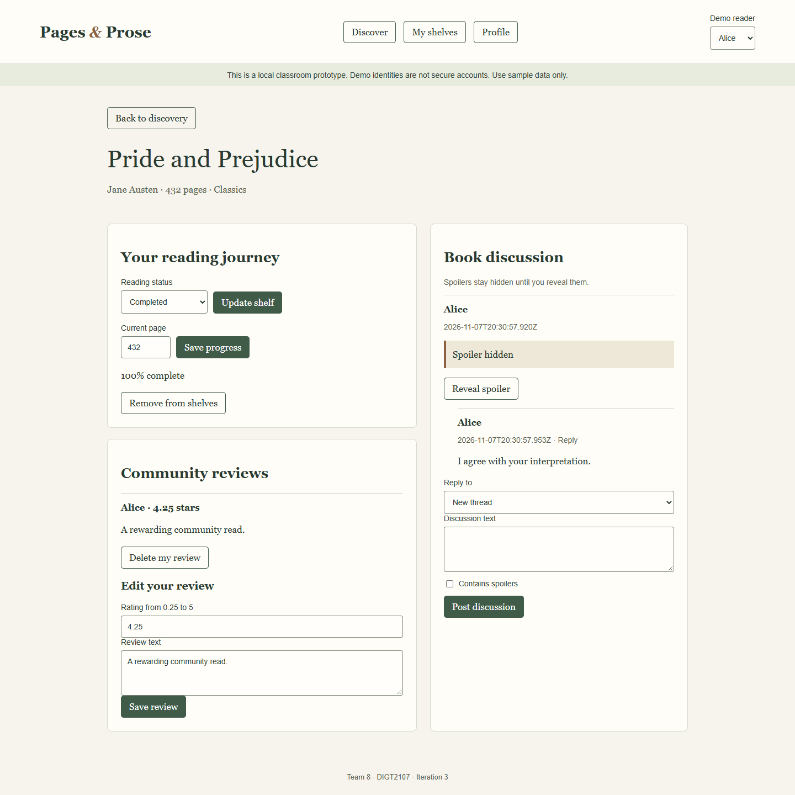

Pages and Prose Testing and Initial Development

# Introduction

Project Name: Pages &amp; ProseTeam Number: 8Team Members: Jeffray Zhang, Liam West, Muskaan Sengupta, Tina Kaus, Arya Holmukhe

Course: DIGT2107 Practice of Software DevelopmentInstructor: Dr. May HaidarDeliverable: 2.1 Project Iteration 3Due Date: November 8, 2026Report Date: November 7, 2026

Pages &amp; Prose brings personal book tracking and community discussion into one reading platform. This iteration turns the high-priority reading loop from Deliverable 1.2 into a working local prototype and links requirements to reproducible tests. The prototype demonstrates search, shelves, progress, reviews, profiles, discussion and spoiler reveal. It does not yet provide secure multi-user accounts or a shared database.

# Iteration Goals and Objectives

1. Implement US2, US3, US4, US5, US7 and the basic US8 spoiler flow, retaining their links to FR3-FR8 and FR11.2. Separate screen rendering, application rules and storage to support later development.3. Run unit and browser tests and preserve actual results, including failures discovered and corrected.4. Plan validation for every functional and non-functional requirement, including features beyond this prototype.5. Prepare a stable release, development and feature branches, documentation and the ITR2.1 milestone tag.

## Response to Deliverable 1 point 2 Feedback

The instructor praised the measurable requirements and requested consistency between stories and requirements, plus clearer evidence of implementation. Sections below resolve the shelf, progress, spoiler and missing-requirement inconsistencies. Screenshots show the running prototype, and test records distinguish validated behaviour from deferred work.

# Prototype Overview

The implementation is a dependency-free JavaScript web prototype. Node.js serves the files locally; the browser runs the application and saves demonstration records in localStorage. Five catalogue fixtures include a missing-page-total book for validation. Covers are generated title panels, not publisher cover artwork.

Figure 1. Actual discovery screen captured during TC-039. Title/author search and View book actions open a shared details screen. Alice is selected as the demonstration reader.

## How to Run

With Node.js 22 or later, run npm start from the repository and open http://127.0.0.1:3000. Select Alice or Bob. Run npm test for unit tests. Browser test setup and commands are in README.md. No database or package installation is needed for the prototype or unit suite.

# Demonstrated Reading and Discussion Flow

Figure 2. Actual book screen after the test saved page 432, explicitly chose Completed, published a 4.25-star review and created a spoiler thread and reply. The thread text is hidden again after switching readers and reloading. Review editing and deletion, status updates and new replies are available on this screen.

The same browser test verified that Bob sees no Alice shelf entries and that Alice retains her Completed book after a real page reload. This demonstrates local behaviour only: selecting a demo reader is not secure authentication.

# Architecture and Implementation Boundaries

| Layer | Files and responsibility |
|---|---|
| Presentation | index.html, styles.css, src/ui.mjs: catalogue, details, shelves and profile views; labelled controls; escaped user text; success/error feedback. |
| Application rules | src/core.mjs: shelf status, completion date, page validation, rating increments, review ownership, thread integrity and spoiler view model. |
| Storage access | src/storage.mjs: BrowserStore and MemoryStore implement load/save. Mutations clone data and save before replacing live state. |
| Test fixtures | src/catalogue.mjs: five local books. Browser performance test substitutes 100 generated records without changing production fixtures. |

Flow: User action → UI handler → ReadingService → storage adapter → updated view. The composition code injects the adapter; screen handlers use service methods. TC-034 runs the same acceptance operations against both adapters. Browser storage failure is caught and displayed without a false success message in TC-041.

## Implemented and Deferred

Implemented: title/author search; book details; three primary shelves; page and completion tracking; own-profile editing; quarter-star review create/edit/delete; public review/profile views; book threads and replies; boolean spoiler hiding and reveal; browser persistence.

Deferred: registration, password hashing, server sessions, real cross-account authorization, custom shelves, follow/feed, sub-ratings, warnings, author verification, EPUB/notes, summaries, buddy-read groups, recommendations, moderation and progress-based spoiler thresholds.

Demo identities and all saved records share one browser origin. The service prevents ordinary cross-reader operations through its API, but browser tools can inspect or change the local records and select either identity. NFR4 and full NFR8 therefore remain unvalidated. localStorage is device-specific, can be cleared, and is not a shared multi-user database. Malformed stored JSON currently stops initialization; recovery is a backlog item.

# Updated Requirements and Consistency Decisions

FR1-FR13 and NFR1-NFR8 retain their Deliverable 1.2 meaning. FR14 is now explicitly defined because 1.2 referenced it only in the traceability matrix. FR15 and FR16 fill the missing functional links for follow/feed and moderation. These additions formalize existing stories/use cases; they do not claim completed features.

| Issue in 1.2 | Resolution for this iteration |
|---|---|
| Shelf wording | US3 primary statuses are Want to Read, Currently Reading and Completed, matching FR4 and UC-02. Favourite Read is not a fourth primary status. Custom shelves remain optional labels in future work. |
| Progress input | US4 and UC-03 accept whole page numbers in this prototype; percentage is derived, not independently entered. FR5 validation governs both bounds and unknown totals. |
| Spoiler wording | FR8 and current US8 accept a boolean spoiler flag with explicit reveal. Page/percentage thresholds are a separately deferred US8 extension, covered by planned TC-019. |
| Author verification | Define FR14 and UC-15 to connect US9 to admin approval, book-specific verification and labelled author posts. |
| Follow/feed and privacy | Define FR15 for US1/UC-06. Feed is limited to public review/discussion activity; private shelf or progress data is excluded. |
| Moderation and buddy reads | Define FR16 for UC-08/UC-10. US12 remains a backlog story for FR12; UC-13 supplies its missing use case. |
| Requirement/story counts | Baseline contained 13 explicit FRs, eight NFRs and 11 detailed stories; US12 and FR14 appeared elsewhere. Current register has 16 FRs and eight NFRs. |

# Functional Requirement Register

FR1: Account registration, sign-in and sign-out with session invalidation.

FR2: View public profiles and edit own display name and description.

FR3: Search title/author and view book details, including a clear empty result.

FR4: Maintain exactly one primary status per user/book; add, move and remove entries; record/clear completion date; support custom shelves.

FR5: Accept whole pages 0 to known positive total; calculate page/total x 100; disable unknown totals and prompt for completion at 100%.

FR6: Publish, browse, edit and delete own ratings/reviews; show review on book and profile.

FR7: Book-specific threads/replies with contributor display name and posting time.

FR8: Contributors flag spoiler content; hide text until deliberate reveal. Page/percentage threshold extension remains in US8 backlog.

Validation coverage is scoped to the complete requirement. FR2 and FR6 are partial because service ownership and public behaviour work, but authenticated ownership still awaits FR1. FR4 is partial because custom shelves are absent. FR8 is fully validated against its basic flag/reveal contract; its proposed threshold extension is separately blocked.

# Functional Requirements Continued

FR9: Read supported EPUBs; owner-only passage notes with create/revisit/delete; safe errors for unreadable files.

FR10: Private date-filtered summaries of completed books, grouped by genre and author.

FR11: Quarter-star overall rating; optional prose/characters/plot sub-ratings and content warnings; preserve old reviews.

FR12: Book-specific buddy groups with invitations, accept/reject and accepted-member-only discussion.

FR13: Recommend by community review count descending; title ascending breaks ties; link book details.

FR14: Allow author applications for specific books; admin approves verification and labelled author participation.

FR15: Follow/unfollow readers; suggestions and feed expose only community-visible activity.

FR16: Report content; admin-only queue and dismissal/removal/warning decisions with audit information.

## Prioritized Story Scope

The prototype implements US2 Search (3 points), the primary-status part of US3 Shelves (3), page-input US4 Progress (2), US5 Reviews (5), US7 Discussions (5), and the basic flag/reveal part of US8 Spoilers (2). The original estimates total 20 points, but are not claimed as 20 fully completed points because the custom-shelf and threshold extensions remain open. US1, US6 and US9-US12 stay in the backlog.

# Non Functional Requirement Register

NFR1: With 100 sample books and one active user, at least 19/20 searches and 19/20 shelf updates finish within 2 seconds from submission to displayed result.

NFR2: Add from details in at most three actions; at least 4/5 first-time readers complete search, add and status change within 3 minutes with only a task prompt.

NFR3: Core controls have visible labels or accessible names, keyboard operation and visible focus; core workflow is mouse-free; status/errors do not rely on colour alone.

NFR4: Authenticated operations reject changes to another user profile, shelf, review or note; dedicated password hashing; sign-out invalidates session.

NFR5: Saved personal records survive reopening; failed save shows error, retains last saved data and never claims success. In-memory adapter is test-only.

NFR6: Separate presentation, application rules and storage. Adapter replacement requires no changes to search or shelf screens; verify same checks and dependencies.

NFR7: Future persistent service: 10,000 books, 50 concurrent users, five-minute trial; at least 95% of searches/updates within 3 seconds and error rate below 1%; record hardware/workload.

NFR8: Shelves, progress, EPUBs, notes and summaries are owner-private; profiles/reviews/public forum community-visible; groups accepted-member-only; verify second-account retrieval.

These targets remain measurable acceptance goals. Prototype measurements apply to the recorded local environment only. In particular, NFR7 was explicitly proposed in 1.2 and is not measured capacity. The assignment does not require a coverage-status label for NFRs, so the NFR matrix lists evidence and remaining work instead.

# Updated Use Cases

| Use case and link | Main flow and exception |
|---|---|
| UC-01 Search; FR3 | Guest enters title/author, opens matching book details; no match shows a clear message. |
| UC-02 Shelves; FR4 | Selected reader adds/moves/removes own book. Exactly one primary status; Completed records date, leaving it clears date. Custom labels deferred. |
| UC-03 Progress; FR5 | Shelved book and known positive total required. Enter whole page; calculate percentage; prompt at 100%. Invalid or unknown total prevents save. |
| UC-04 Review; FR6/11 | Selected reader publishes or edits own quarter-star review; book/profile update. Optional sub-ratings/warnings await later development. |
| UC-05 Browse reviews; FR6/11 | Guest views public reviews and profiles; empty state when no reviews. Future fields preserve older reviews. |
| UC-06 Follow/feed; FR15 | Authenticated reader follows/unfollows and views eligible public activity. No private shelf/progress activity is exposed. |
| UC-07 Discussion; FR7/8 | Read book-specific forum; selected reader posts thread/reply with identity/time and optional spoiler flag. Blank or cross-book reply rejected; reveal is deliberate. |
| UC-08 Report; FR16 | Authenticated reader reports visible content; confirmation and queue entry; report does not automatically remove content. |
| UC-09 Summary; FR10 | Authenticated owner selects date range; show total/genre/author counts; empty period returns zero. |
| UC-10 Moderate; FR16 | Admin inspects report, dismisses/removes/warns and records resolution. Reader access denied; already-removed content handled. |

UC-01 to UC-10 keep their previous IDs. UC-02/03/04/07 are clarified for current scope; UC-06/08/10 gain explicit FR links. UC-06 and UC-08 to UC-10 remain planned rather than demonstrated.

# Added Use Cases for Previously Unmapped Requirements

## UC-11 Account and Profile FR1 FR2

Preconditions: Guest or authenticated owner; account service available.Trigger and main flow: Guest registers, signs in, edits own display name/bio, then signs out.Alternatives: Duplicate email, wrong credentials or cross-owner edit is rejected; invalidated session cannot be reused.Postconditions: Public profile updated; session state reflects sign-in/out. Demo implements editing only.

## UC-12 EPUB and Notes FR9

Preconditions: Authenticated owner with supported EPUB.Trigger and main flow: Owner imports file, opens passage, saves note, reopens and deletes it.Alternatives: Unsupported/corrupt file gives error without losing notes; another account cannot access file or notes.Postconditions: Owner notes retain passage anchors; deletion removes only selected note.

## UC-13 Buddy Reads FR12

Preconditions: Authenticated owner and intended invitee; book exists.Trigger and main flow: Create book group, invite reader, accept invitation, enter group discussion.Alternatives: Reject/pending invite grants no access; non-member direct access is denied.Postconditions: Membership decision and accepted-member discussion access persist.

## UC-14 Recommendations FR13

Preconditions: Community catalogue and review counts available; public reader.Trigger and main flow: Open suggestions ranked by count descending and title ascending; select a book.Alternatives: No activity produces an explicit empty/fallback result.Postconditions: Correct public book details open without changing personal data.

## UC-15 Author Verification FR14

Preconditions: Applicant account and admin role; book exists.Trigger and main flow: Author submits book-specific application; admin approves; author contributes with visible badge.Alternatives: Non-admin approval rejected; rejection does not grant badge.Postconditions: Verification decision retained and public posts reflect approved identity.

# Requirement to Test Case Traceability

Every requirement has one or more designed test cases. Designed coverage means a test is specified; it does not mean the feature exists or that it passed. Functional validation below uses Full for the complete current contract, Partial for only some behaviour validated, and Uncovered for no implemented validation of the full feature. A passing demo test does not establish authenticated security.

| ID and use case | Requirement summary | Test cases | Validation |
|---|---|---|---|
| FR1
UC-11 | Account registration, sign-in and sign-out with session invalidation. | TC-001, TC-031, TC-038 | Uncovered |
| FR2
UC-11 | View public profiles and edit own display name and description. | TC-002, TC-031, TC-032, TC-040 | Partial |
| FR3
UC-01 | Search title/author and view book details, including a clear empty result. | TC-003, TC-004, TC-039, TC-042 | Full |
| FR4
UC-02 | Maintain exactly one primary status per user/book; add, move and remove entries; record/clear completion date; support custom shelves. | TC-005, TC-006, TC-007, TC-008, TC-012, TC-031, TC-039, TC-043, TC-044 | Partial |
| FR5
UC-03 | Accept whole pages 0 to known positive total; calculate page/total x 100; disable unknown totals and prompt for completion at 100%. | TC-009, TC-010, TC-011, TC-012, TC-039, TC-042, TC-043 | Full |
| FR6
UC-04, UC-05 | Publish, browse, edit and delete own ratings/reviews; show review on book and profile. | TC-013, TC-014, TC-015, TC-031, TC-037, TC-039, TC-040, TC-042 | Partial |
| FR7
UC-07 | Book-specific threads/replies with contributor display name and posting time. | TC-016, TC-017, TC-039, TC-040, TC-042 | Full |
| FR8
UC-07 | Contributors flag spoiler content; hide text until deliberate reveal. Page/percentage threshold extension remains in US8 backlog. | TC-018, TC-019, TC-039 | Full |

# Functional Traceability Continued

| ID and use case | Requirement summary | Test cases | Validation |
|---|---|---|---|
| FR9
UC-12 | Read supported EPUBs; owner-only passage notes with create/revisit/delete; safe errors for unreadable files. | TC-020, TC-031, TC-036 | Uncovered |
| FR10
UC-09 | Private date-filtered summaries of completed books, grouped by genre and author. | TC-021, TC-036 | Uncovered |
| FR11
UC-04, UC-05 | Quarter-star overall rating; optional prose/characters/plot sub-ratings and content warnings; preserve old reviews. | TC-014, TC-022 | Partial |
| FR12
UC-13 | Book-specific buddy groups with invitations, accept/reject and accepted-member-only discussion. | TC-023, TC-036 | Uncovered |
| FR13
UC-14 | Recommend by community review count descending; title ascending breaks ties; link book details. | TC-024 | Uncovered |
| FR14
UC-15 | Allow author applications for specific books; admin approves verification and labelled author participation. | TC-025 | Uncovered |
| FR15
UC-06 | Follow/unfollow readers; suggestions and feed expose only community-visible activity. | TC-026 | Uncovered |
| FR16
UC-08, UC-10 | Report content; admin-only queue and dismissal/removal/warning decisions with audit information. | TC-027 | Uncovered |

Totals: 4 functional requirements fully validated (FR3, FR5, FR7, FR8), 4 partially validated (FR2, FR4, FR6, FR11), and 8 uncovered (FR1, FR9, FR10, FR12-FR16). All 16 have designed tests. This measures validation progress, not source-code line or branch coverage.

# Non Functional Traceability and Evidence

| ID | Tests | Evidence and remaining work |
|---|---|---|
| NFR1 | TC-028 | Recorded 100-book browser timings meet the local 19/20 threshold for search and updates. Display proxy uses DOM update and two animation frames. |
| NFR2 | TC-029 | Test protocol specified. Five first-time participants and task/action observations still required. |
| NFR3 | TC-030 | Keyboard sample passed after a search focus repair. Full tab-order, all controls and assistive-technology review still required. |
| NFR4 | TC-001/015/020/025/027/031/037 | Service review ownership and escaped review text tested. Authentication, hashes, session revocation and server access checks await backend. |
| NFR5 | TC-010/022/032/033/039/041 | Adapter reload, actual browser reload, application atomic-save failures and visible browser storage error passed. Enhanced-review migration deferred. |
| NFR6 | TC-034 | Adapter contract passed for MemoryStore and BrowserStore; UI screen handlers use the service. Composition still selects the adapter. |
| NFR7 | TC-035 | 10,000-book / 50-user / 5-minute persistent-service trial specified; backend absent, so no capacity result claimed. |
| NFR8 | TC-007/020/021/023/026/036/040/043 | Demo shelf isolation and public visibility passed. EPUB, summary, group and authenticated retrieval protection remain unvalidated. |

Gaps are actionable: add authentication before treating local ownership rules as security; finish custom shelves and review enhancements before marking FR4/FR11 full; recruit usability participants; complete keyboard audit; build persistent storage before scalability and private retrieval testing. Test outcomes for future features remain Blocked rather than fabricated Pass results.

# Test Plan and Actual Results

Scope: unit tests validate deterministic service behaviour and adapter contracts; browser checks validate the integrated reading flow, rendering, keyboard sample, failure feedback and local performance. Tests for deferred features are fully specified for later execution.

Fixtures: Alice/Bob demo readers; b1 432 pages, b2 280 pages and b5 unknown pages; fixed clock for unit completion checks; fresh storage for browser run; generated 100-book performance catalogue. Future private-access tests add a third account, backend credentials and invitation states.

Environment: win32 10.0.26300; Node v22.21.0; Chrome 157.0.8103.38 controlled with Playwright; AMD Ryzen 7 8700F 8-Core Processor; 32 GiB RAM; 1440 x 1050 viewport; local loopback server and browser localStorage. Test run: November 7, 2026, 20:30:57 UTC (Toronto UTC-5).

| Result category | Recorded outcome |
|---|---|
| Designed cases | 44 unique cases covering 16 FRs and eight NFRs. |
| Unit suite | 24 tests passed, 0 failed; node --test tests/core.test.mjs; raw TAP in docs/testing/unit-results.tap. |
| Browser suite | 5 checks passed, 0 failed; tests/browser.mjs; raw environment/timings in docs/testing/browser-results.json. |
| Case status totals | 29 Pass; 15 Blocked. Blocked indicates missing feature or test prerequisite, not a passing feature. |
| Regression discovered | Initial keyboard search check failed because rerender lost focus. Search handler now focuses replacement Search button; repeated browser suite passed. |
| Exit assessment | Core local demonstration passes available automated checks. Production security, full privacy, first-time usability, full accessibility and scalability remain release gaps. |

## Execution and Defect Handling

Start clean fixtures, execute the case steps, retain raw output and screenshots, and compare actual to expected. Mark Pass only when all assertions for that case succeed; Fail for observed mismatch; Blocked when prerequisites are unavailable. Record requirement/test ID, reproduction, expected/actual, severity, owner and evidence for each defect; fix in a feature branch and rerun the affected checks. A regression that affects shared state triggers the full unit suite and browser journey.

# Detailed Test Cases

Each case includes the nine fields required by the assignment. Tests marked Blocked specify expected future behaviour and their missing prerequisite. Pass denotes only the scope stated in that case; broader requirement gaps remain in the traceability matrix.

## TC-001 Account registration and session lifecycle
Related requirements: FR1, NFR4Preconditions: Future authentication service; unused email; two browser sessions.Steps: 1. Register a reader with a valid email and password. 2. Reject duplicate email and wrong password. 3. Sign in, capture the session, then sign out. 4. Retry a protected request with the old session.Expected: Registration succeeds once; passwords are hashed with a dedicated password hash; invalid credentials fail; sign-out invalidates the session.Actual: Blocked: demo selection has no registration, password storage or authenticated server session.Status: Blocked &nbsp; Priority: High

## TC-002 Edit profile and retain community reviews
Related requirements: FR2Preconditions: Alice selected; fresh service and b1 available.Steps: 1. Publish a 4-star b1 review. 2. Save display name &quot; Alice A &quot; and bio &quot; Bio &quot;. 3. Read Alice profile and its reviews. 4. Attempt a blank display name.Expected: Name and bio are trimmed and updated; review remains visible; blank name is rejected.Actual: Automated assertions passed; see matching ID in unit-results.tap.Status: Pass &nbsp; Priority: High

## TC-003 Search title or author and read details
Related requirements: FR3Preconditions: Fresh catalogue with b1 Pride and Prejudice and b2 Frankenstein.Steps: 1. Search &quot; PRIDE &quot;. 2. Search &quot;shelley&quot;. 3. Open b1 details.Expected: Queries are case-insensitive and trimmed; correct book returned; details show title, author and 432 pages.Actual: Automated assertions passed; see matching ID in unit-results.tap.Status: Pass &nbsp; Priority: High

## TC-004 Empty and unmatched search
Related requirements: FR3Preconditions: Five-book sample catalogue.Steps: 1. Submit whitespace only. 2. Search &quot;zzzzzz&quot;.Expected: Whitespace returns all five books; unmatched query returns an empty result set; UI no-results text is checked during manual follow-up.Actual: Automated assertions passed; see matching ID in unit-results.tap.Status: Pass &nbsp; Priority: High

# Detailed Test Cases Continued

## TC-005 Add and move one primary shelf record
Related requirements: FR4Preconditions: Alice selected and b1 absent from her shelves.Steps: 1. Add b1 as Want to Read. 2. Move b1 to Currently Reading. 3. Attempt Favourite Read as primary status.Expected: Exactly one record remains with Currently Reading; unsupported primary status is rejected.Actual: Automated assertions passed; see matching ID in unit-results.tap.Status: Pass &nbsp; Priority: High

## TC-006 Completion date lifecycle
Related requirements: FR4Preconditions: Alice selected; fixed test clock 2026-11-07T18:00:00Z.Steps: 1. Mark b1 Completed. 2. Inspect completedAt. 3. Move b1 to Want to Read.Expected: Completion date equals the test clock; leaving Completed clears that date.Actual: Automated assertions passed; see matching ID in unit-results.tap.Status: Pass &nbsp; Priority: High

## TC-007 Remove only the current reader shelf entry
Related requirements: FR4, NFR8Preconditions: Alice and Bob each have b1 on a shelf.Steps: 1. As Bob remove b1. 2. Read Bob shelves. 3. Switch to Alice and read her shelves.Expected: Bob has no b1 entry; Alice entry is retained.Actual: Automated assertions passed; see matching ID in unit-results.tap.Status: Pass &nbsp; Priority: High

## TC-008 Custom shelf organisation
Related requirements: FR4Preconditions: Future custom-shelf UI and service; Alice owns a b1 entry.Steps: 1. Create shelf &quot;Summer&quot;. 2. Assign b1 while retaining its primary status. 3. Rename shelf then remove the custom membership.Expected: Custom label changes do not duplicate or erase the primary status or progress.Actual: Blocked: custom shelf creation and membership are not implemented.Status: Blocked &nbsp; Priority: Medium

# Detailed Test Cases Continued

## TC-009 Progress boundaries and calculation
Related requirements: FR5Preconditions: Alice has b1 Currently Reading; total 432 pages.Steps: 1. Save pages 0, 216 and 432 in sequence. 2. Inspect percentage after each save.Expected: All values accepted; percentages are exactly 0, 50 and 100.Actual: Automated assertions passed; see matching ID in unit-results.tap.Status: Pass &nbsp; Priority: High

## TC-010 Reject invalid progress without data loss
Related requirements: FR5, NFR5Preconditions: Alice has b1 page 20 saved.Steps: 1. Attempt -1, 433, 1.5, NaN, Infinity and string &quot;10&quot; through the service. 2. Read the stored page.Expected: Each invalid input is rejected and page 20 remains. UI converts valid numeric input before calling the service.Actual: Automated assertions passed; see matching ID in unit-results.tap.Status: Pass &nbsp; Priority: High

## TC-011 Unknown and zero page totals
Related requirements: FR5Preconditions: b5 has missing pages; Alice has shelved it.Steps: 1. Attempt to save page 0. 2. Repeat with b5 total pages set to zero.Expected: Both saves are rejected as tracking unavailable; percentage is not calculated.Actual: Automated assertions passed; see matching ID in unit-results.tap.Status: Pass &nbsp; Priority: High

## TC-012 Prompt before recording completion
Related requirements: FR5, FR4Preconditions: Alice has b1 Currently Reading.Steps: 1. Save page 432. 2. Inspect status and completion prompt flag. 3. Explicitly move to Completed and repeat save.Expected: Last-page save requests confirmation without changing status; Completed suppresses further prompts.Actual: Automated assertions passed; see matching ID in unit-results.tap.Status: Pass &nbsp; Priority: High

# Detailed Test Cases Continued

## TC-013 Review create edit delete and profile link
Related requirements: FR6Preconditions: Alice selected, b1 available, no existing review.Steps: 1. Publish 4-star review &quot; Good &quot;. 2. Find it on the book and profile. 3. Edit to 4.25 stars and &quot;Better&quot;. 4. Delete the review.Expected: One trimmed review is created; edits replace it; deletion removes it from book and profile.Actual: Automated assertions passed; see matching ID in unit-results.tap.Status: Pass &nbsp; Priority: High

## TC-014 Quarter-star boundaries and increments
Related requirements: FR6, FR11Preconditions: Alice selected and b1 available.Steps: 1. Save every value from 0.25 to 5 in 0.25 increments. 2. Attempt 0, 5.25, 4.1, NaN, Infinity and string &quot;4&quot;.Expected: All 20 valid values are accepted; every invalid value is rejected without creating a second review.Actual: Automated assertions passed; see matching ID in unit-results.tap.Status: Pass &nbsp; Priority: High

## TC-015 Review ownership through application rules
Related requirements: FR6, NFR4Preconditions: Alice has an existing b1 review.Steps: 1. Switch to Bob. 2. Attempt to edit Alice review by its ID. 3. Attempt to delete it. 4. Read the review.Expected: Both operations are rejected and original text remains. This checks demo service ownership, not authenticated security.Actual: Automated assertions passed; see matching ID in unit-results.tap.Status: Pass &nbsp; Priority: High

## TC-016 Book-specific threads and replies
Related requirements: FR7Preconditions: Alice selected; b1 and b2 exist; fixed test clock.Steps: 1. Create a b1 thread. 2. Reply to its ID. 3. Inspect b1 and b2 discussions.Expected: b1 contains thread and reply with author, parent and timestamp; b2 contains neither.Actual: Automated assertions passed; see matching ID in unit-results.tap.Status: Pass &nbsp; Priority: High

# Detailed Test Cases Continued

## TC-017 Reject invalid discussion contributions
Related requirements: FR7Preconditions: Alice has a thread on b1.Steps: 1. Attempt whitespace-only post. 2. Reply to an absent thread. 3. Reply on b2 using the b1 parent ID.Expected: Every invalid contribution fails; no extra posts are saved.Actual: Automated assertions passed; see matching ID in unit-results.tap.Status: Pass &nbsp; Priority: High

## TC-018 Spoilers hidden until explicit reveal
Related requirements: FR8Preconditions: Alice posts b1 text &quot;Ending&quot; flagged as spoiler.Steps: 1. Read discussion without revealed IDs. 2. Read it with the post ID explicitly revealed. 3. Read again without that ID.Expected: Hidden view contains no spoiler text; explicit reveal returns text; a new view defaults to hidden.Actual: Automated assertions passed; see matching ID in unit-results.tap.Status: Pass &nbsp; Priority: High

## TC-019 Page-based spoiler thresholds
Related requirements: FR8Preconditions: Future threshold metadata and UI; readers at different progress points.Steps: 1. Flag a post at page 200 of 432. 2. Open as readers below and above page 200. 3. Explicitly reveal as the reader below page 200.Expected: Future threshold feature respects each reader progress and deliberate reveal; no spoiler text leaks into hidden content.Actual: Blocked: US8 threshold extension deferred; current FR8 boolean flag and reveal are tested in TC-018 and TC-039.Status: Blocked &nbsp; Priority: Medium

## TC-020 EPUB notes privacy and invalid files
Related requirements: FR9, NFR4, NFR8Preconditions: Future EPUB reader; valid EPUB, corrupt EPUB and non-EPUB files; Alice and Bob.Steps: 1. Open valid EPUB; create, reopen and delete a passage note. 2. Attempt Bob access to Alice note. 3. Import corrupt and unsupported files.Expected: Notes retain correct passage anchors and owner privacy; invalid files show errors without removing saved notes.Actual: Feature is outside the implemented prototype; execution awaits its implementation.Status: Blocked &nbsp; Priority: Low

# Detailed Test Cases Continued

## TC-021 Date-filtered reading summaries
Related requirements: FR10, NFR8Preconditions: Future analytics; known completion dates including date-range boundaries, genres and authors.Steps: 1. Select an inclusive date range. 2. Compare total and per-genre/per-author counts to fixtures. 3. Select an empty range. 4. Attempt Bob access to Alice summary.Expected: Counts match boundary fixtures; empty range is zero; Bob cannot retrieve Alice summary.Actual: Feature is outside the implemented prototype; execution awaits its implementation.Status: Blocked &nbsp; Priority: Low

## TC-022 Optional sub-ratings warnings and migration
Related requirements: FR11, NFR5Preconditions: Future enhanced review editor; existing overall-only review.Steps: 1. Reopen old review. 2. Save without sub-ratings. 3. Add prose, characters and plot sub-ratings and warnings. 4. Reject an invalid sub-rating and reopen.Expected: Old review remains readable; fields are optional; valid details persist; invalid save leaves the last saved version intact.Actual: Feature is outside the implemented prototype; execution awaits its implementation.Status: Blocked &nbsp; Priority: Medium

## TC-023 Buddy-read invitation and membership privacy
Related requirements: FR12, NFR8Preconditions: Future buddy-read groups; Alice, Bob and non-member Charlie.Steps: 1. Alice creates b1 group and invites Bob. 2. Bob rejects then accepts a new invitation. 3. Charlie attempts direct group read/write. 4. Bob opens discussion after acceptance.Expected: Rejected or unaccepted members have no access; accepted Bob can read/write; Charlie is denied.Actual: Feature is outside the implemented prototype; execution awaits its implementation.Status: Blocked &nbsp; Priority: Medium

## TC-024 Deterministic community recommendations
Related requirements: FR13Preconditions: Future recommendation service; books with 3, 2, 2 and 0 reviews.Steps: 1. Request recommendations. 2. Verify descending review counts and alphabetical title tie-break. 3. Follow each book link. 4. Repeat with no reviews.Expected: Correct stable order and detail links; empty activity is handled clearly.Actual: Feature is outside the implemented prototype; execution awaits its implementation.Status: Blocked &nbsp; Priority: Medium

# Detailed Test Cases Continued

## TC-025 Verified author application and admin decision
Related requirements: FR14, NFR4Preconditions: Future author verification; reader, applicant and admin accounts.Steps: 1. Apply for a specific book. 2. Attempt verification as ordinary reader. 3. Approve as admin. 4. Post as the verified author.Expected: Only admin can verify; badge is tied to the approved author/book; posts visibly identify author; failed applications do not grant a badge.Actual: Feature is outside the implemented prototype; execution awaits its implementation.Status: Blocked &nbsp; Priority: Medium

## TC-026 Follow feed without private activity leakage
Related requirements: FR15, NFR8Preconditions: Future follow/feed service; Alice and Bob with public reviews and private shelf activity.Steps: 1. Alice follows Bob. 2. Inspect following list, suggestions and feed. 3. Confirm only public activity appears. 4. Unfollow and publish another Bob review.Expected: Following list and eligible review feed update; private progress and shelves never appear; unfollowed future activity is excluded.Actual: Feature is outside the implemented prototype; execution awaits its implementation.Status: Blocked &nbsp; Priority: Medium

## TC-027 Report and moderate with role enforcement
Related requirements: FR16, NFR4Preconditions: Future reports and moderation; existing review/thread; reader and admin.Steps: 1. Report content; verify confirmation without automatic removal. 2. Attempt reader access to queue. 3. Admin dismisses one report and removes another item. 4. Resolve a report whose content was already removed.Expected: Reader queue access denied; resolution action, admin and timestamp recorded; removed content hidden; already-removed case handled.Actual: Feature is outside the implemented prototype; execution awaits its implementation.Status: Blocked &nbsp; Priority: Medium

## TC-028 Measure 100-book browser performance
Related requirements: NFR1Preconditions: Fresh local browser; 100 generated book fixtures; one selected reader; fixed viewport.Steps: 1. Run 20 title searches. 2. Run 20 alternating shelf-status saves. 3. Time submission through DOM update and two animation frames. 4. Record environment and all timings.Expected: At least 19 of 20 searches AND 19 of 20 shelf updates complete within 2,000 ms.Actual: 100 books, one reader: 20/20 searches and 20/20 updates within 2 seconds; maxima 6.6 ms and 6.5 ms.Status: Pass &nbsp; Priority: High

# Detailed Test Cases Continued

## TC-029 First-time usability and action count
Related requirements: NFR2Preconditions: Five first-time participants, fresh demo data and a timer; no coaching.Steps: 1. Give only: &quot;Find Frankenstein, add it, then mark Currently Reading&quot;. 2. Count actions from book details to shelf addition. 3. Record completion time and errors for each participant.Expected: Shelf addition takes at most three actions; at least four of five participants finish the full task within three minutes.Actual: Blocked: five first-time participants have not been recruited; no user-study results claimed.Status: Blocked &nbsp; Priority: Medium

## TC-030 Keyboard access labels and focus sample
Related requirements: NFR3Preconditions: Browser with Alice selected and fresh interactive page.Steps: 1. Inspect discovery input labels. 2. Focus search once, then type and use Tab/Enter to open Frankenstein. 3. Use keyboard after setting focus to shelf, progress and review controls. 4. Inspect focus outline and textual feedback.Expected: Sample operations work without mouse clicks; discovery controls have labels; focus is visible and status/error text is readable. Full sequential-navigation and screen-reader audit remains required.Actual: Search, open, add, progress and review operated with keyboard after programmatic focus; visible 3px outline and labels checked on discovery. Full manual keyboard and assistive-technology audit pending.Status: Pass &nbsp; Priority: Medium

## TC-031 Authenticated security across protected operations
Related requirements: NFR4, FR1, FR2, FR4, FR6, FR9Preconditions: Future backend authentication; two accounts; password database and invalidated session fixtures.Steps: 1. Inspect password hashes. 2. Use Bob credentials to alter Alice profile, shelf, review and note by ID. 3. Sign out Alice and replay the old session.Expected: Every cross-account write and invalidated-session request is denied server-side; passwords use a dedicated password-hashing function.Actual: Blocked: browser demo selection and localStorage cannot meet backend authentication or security requirements.Status: Blocked &nbsp; Priority: High

## TC-032 Reload through storage adapter
Related requirements: NFR5, FR2, FR4, FR5, FR6, FR7Preconditions: Map-backed browser-storage test double; fresh service.Steps: 1. Save profile, shelf, page, review and discussion. 2. Construct a new service using the same stored JSON. 3. Read each record.Expected: All saved values remain. TC-039 separately verifies an actual browser reload.Actual: Automated assertions passed; see matching ID in unit-results.tap.Status: Pass &nbsp; Priority: High

# Detailed Test Cases Continued

## TC-033 Failed application saves are atomic
Related requirements: NFR5Preconditions: MemoryStore with one saved shelf; inject save exception &quot;Disk full&quot;.Steps: 1. Try changing shelf, progress, removing entry, publishing review/post and editing profile. 2. After each error compare service state and adapter state to original.Expected: Every operation throws; neither last saved state nor in-memory application state changes.Actual: Automated assertions passed; see matching ID in unit-results.tap.Status: Pass &nbsp; Priority: High

## TC-034 Replace storage without changing screens
Related requirements: NFR6Preconditions: MemoryStore and BrowserStore test double implementing load/save.Steps: 1. Run identical search, shelf and progress assertions with each adapter. 2. Review UI imports and service dependency boundaries.Expected: Same application contract works with both adapters; screens use ReadingService methods; no direct data reads/writes in screen handlers. UI composition still selects an adapter.Actual: Automated assertions passed; see matching ID in unit-results.tap.Status: Pass &nbsp; Priority: Medium

## TC-035 Future persistent-service scalability target
Related requirements: NFR7Preconditions: Future deployed persistent service; 10,000 books; 50 concurrent authenticated users; recorded hardware.Steps: 1. Run mixed search and shelf-update workload for five minutes. 2. Measure each action end to end. 3. Calculate fraction within three seconds and application error rate.Expected: At least 95% of actions finish within three seconds and error rate is below 1%; publish hardware, workload and raw measurements.Actual: Blocked: persistent multi-user service does not exist; local performance timings cannot validate this target.Status: Blocked &nbsp; Priority: Low

## TC-036 Private records cannot be retrieved by another account
Related requirements: NFR8, FR4, FR5, FR9, FR10, FR12Preconditions: Future authenticated backend; Alice private shelves, progress, EPUB, notes, summary and group.Steps: 1. As Bob request each Alice resource by direct ID and list endpoints. 2. Attempt unaccepted group discussion reads. 3. Verify public profile, review and forum remain accessible.Expected: All private resource retrieval is denied, not just hidden in UI; public resources remain visible.Actual: Blocked: full privacy needs authenticated server storage; demo isolation in TC-043 is insufficient.Status: Blocked &nbsp; Priority: High

# Detailed Test Cases Continued

## TC-037 Render untrusted review text safely
Related requirements: FR6, NFR4Preconditions: Browser demo with Alice selected and b1 details.Steps: 1. Save review text &lt;img src=x onerror=&quot;window.xssExecuted=true&quot;&gt;. 2. Inspect rendered DOM and window execution marker.Expected: Text displays literally; no injected image or script executes. This is one rendering check, not a complete security audit.Actual: Review payload rendered as literal text; no image element or script execution.Status: Pass &nbsp; Priority: High

## TC-038 Guest access boundary
Related requirements: FR1, FR2, FR3, FR4, FR5, FR6, FR7Preconditions: Fresh service signed out.Steps: 1. Search and read public reviews. 2. Attempt private shelf access and each profile/shelf/progress/review/post mutation.Expected: Public reads work; all listed operations requiring a selected reader are rejected. Real authentication remains deferred.Actual: Automated assertions passed; see matching ID in unit-results.tap.Status: Pass &nbsp; Priority: High

## TC-039 Browser reading and discussion journey
Related requirements: FR3, FR4, FR5, FR6, FR7, FR8, NFR5Preconditions: Fresh browser using the five-book catalogue; Alice and Bob demo identities.Steps: 1. Search Austen and open book. 2. Add, move, reach final page and confirm Completed. 3. Save 4.25-star review; post spoiler thread and reply. 4. Reveal spoiler then switch to Bob. 5. Reload, select Alice and inspect shelf.Expected: Workflow renders correct data; spoiler text absent before reveal and hidden again after reader switch; Bob shelves empty; Alice Completed survives reload; no page errors.Actual: Search, add, move, progress prompt, review, spoiler reveal, reply, reader isolation and real page reload passed; two screenshots saved; no page errors.Status: Pass &nbsp; Priority: High

## TC-040 Public profile review and discussion visibility
Related requirements: FR2, FR6, FR7, NFR8Preconditions: Alice selected in fresh service.Steps: 1. Publish review and ordinary post. 2. Sign out and read book reviews, Alice public profile and discussion.Expected: All community-visible content remains readable; no private shelves are included in the public profile object.Actual: Automated assertions passed; see matching ID in unit-results.tap.Status: Pass &nbsp; Priority: High

# Detailed Test Cases Continued

## TC-041 Browser save error and truthful feedback
Related requirements: NFR5Preconditions: Browser has a saved Completed entry; inject localStorage.setItem failure.Steps: 1. Try changing status to Want to Read. 2. Inspect message. 3. Restore storage and reopen My shelves.Expected: Error text appears instead of success; last saved Completed status remains.Actual: Failed browser save displayed an error and retained Completed; no success message.Status: Pass &nbsp; Priority: High

## TC-042 Reject unknown resources and unshelved progress
Related requirements: FR3, FR4, FR5, FR6, FR7Preconditions: Alice selected with no shelves.Steps: 1. Request absent book details. 2. Try shelf, review and thread with absent book ID. 3. Update b1 progress before shelving it.Expected: Every invalid operation is rejected; no shelf records are created.Actual: Automated assertions passed; see matching ID in unit-results.tap.Status: Pass &nbsp; Priority: High

## TC-043 Demo reading-list separation
Related requirements: FR4, FR5, NFR8Preconditions: Alice selected in fresh service.Steps: 1. Alice shelves b1. 2. Switch to Bob and try shelves(&quot;alice&quot;). 3. Bob shelves b2. 4. Switch back to Alice.Expected: Bob gets no Alice list and owner override is rejected; Alice still sees only b1. Browser data remains inspectable locally, so this is not full NFR8 validation.Actual: Automated assertions passed; see matching ID in unit-results.tap.Status: Pass &nbsp; Priority: High

## TC-044 Completion date remains stable on repeat saves
Related requirements: FR4Preconditions: Alice selected; controlled clock can advance one day.Steps: 1. Complete b1. 2. Advance clock and save Completed again. 3. Move away from Completed then complete again.Expected: Repeated same-status save preserves first date; a later new completion records the new date.Actual: Automated assertions passed; see matching ID in unit-results.tap.Status: Pass &nbsp; Priority: Medium

# Updated Iteration Plan and Task Allocation

These are proposed responsibilities for the next work cycle; they do not assert that any member has already completed these tasks. The course Week 6-9 roadmap from 1.1 remains the development/testing phase. Deliverable 2.1 is the current November 8 checkpoint; the next three-week plan is below.

| Member | Proposed coding testing and documentation responsibility |
|---|---|
| Jeffray Zhang | Maintain core reading integration and release branch; progress/shelf regressions; reconcile traceability and assemble submission evidence. |
| Liam West | Develop authentication/session and ownership boundaries; unauthorized-operation tests; document security decisions and setup. |
| Muskaan Sengupta | Develop review sub-ratings/warnings; validation and old-review migration tests; update FR11 and acceptance examples. |
| Tina Kaus | Refine discovery/shelf/profile interaction and custom shelves; coordinate five-reader usability and keyboard audit; document observed feedback. |
| Arya Holmukhe | Extend forum/spoiler and moderation work; thread/access tests; maintain use cases, defect records and future group-test fixtures. |

| Time window | Deliverables and exit checks |
|---|---|
| Current checkpoint Nov 7-8 | Complete core prototype, 24 unit tests, five browser checks, 44-case plan and report. Publish reviewed branches and tag ITR2.1; verify remote files before eClass PDF submission. |
| Week 1 Nov 9-15 | Prioritize FR1/NFR4 backend and session boundaries; prototype custom shelves. Exit: authentication and unauthorized-write tests run against backend, failures recorded. |
| Week 2 Nov 16-22 | Integrate persistence and enhanced reviews; run reload/failure/migration checks; conduct five-reader study and full keyboard audit. Exit: actual observations and requirement gaps recorded. |
| Week 3 Nov 23-29 | Resolve critical regressions, demonstrate integrated workflow and collect feedback. Reassess future scale test readiness; do not run capacity claims on the single-browser mock. |

# Prioritized Backlog and Risks

| Order | Work and linked tests | Dependency or completion rule |
|---|---|---|
| 1 | FR1/NFR4 real accounts and sessions; TC-001/031 | Blocks trustworthy ownership/privacy and future multi-user trials. |
| 2 | FR4 custom shelves; TC-008 | Preserve exactly one primary status; custom labels do not overwrite progress. |
| 3 | NFR2/3 participant and full keyboard checks; TC-029/030 | Recruit five new readers; finish sequential focus, screen-reader and textual-feedback audit. |
| 4 | FR11 sub-ratings/content warnings; TC-022 | Keep existing quarter-star reviews readable; old-record migration tests. |
| 5 | FR15 follow/feed; TC-026 | Only public activity can enter feed; privacy rules require authenticated service. |
| 6 | FR14/16 verification/moderation; TC-025/027 | Admin role and auditable decisions first; normal readers cannot approve/remove content. |
| 7 | FR12 groups and FR13 recommendations; TC-023/024 | Invitation access enforcement and deterministic ranking fixtures. |
| 8 | FR10 summary and FR9 EPUB notes; TC-020/021 | Owner-private storage; supported-file/error and date-range fixtures. |
| 9 | US8 threshold spoilers; TC-019 | Retain deliberate reveal; define page/percentage compatibility. |
| 10 | NFR7 scale and corrupted-local-data recovery | Persistent backend and workload generator before TC-035; separately add safe initialization recovery. |

Highest risks are overclaiming security from local demo selection, losing browser data when storage is cleared, and confusing planned test coverage with executed validation. The visible demo notice, atomic-save checks, explicit test statuses and partial/uncovered functional labels address these risks at the current checkpoint.

# Repository Organization and Version Control

Repository: https://github.com/tqeng/pages-proseCommit author: JeffrayZhang &lt;zhangjeffray@gmail.com&gt;, using the existing Git configuration. These commits reflect actual development sessions and are not backdated.

| Branch or artifact | Purpose |
|---|---|
| main | Stable reviewed milestone; release integration occurs after tests and report checks. |
| development | Integration branch for ongoing work; receives verified feature changes. |
| feature/core-reading | Reading/community application implementation. |
| feature/testing | Executable tests, failure repair, measured results and screenshots. |
| feature/deliverable-2-1 | Requirement reconciliation, 44-case plan, traceability, iteration plan and formatted PDF. |
| ITR2.1 | Annotated milestone tag for the stable submission commit. Remote publication must be verified before submission. |
| docs/deliverable-2-1.pdf and .md | Formatted eClass submission and editable text source. |
| docs/testing/ | test-cases.json, traceability.csv, test-plan.md, unit-results.tap, browser-results.json and browser-run.txt. |
| docs/evidence/ and tests/ | Actual prototype screenshots and executable unit/browser test suites. |

Workflow: create a feature branch from development; implement one coherent change; run relevant checks; commit with a clear description; integrate to development; run release checks; merge the stable checkpoint to main and add the annotated ITR2.1 tag. Preserve feature branches for review. Avoid rewriting existing shared history.

## Submission Verification

Before eClass submission, verify that GitHub main, development and feature branches contain their intended work; confirm ITR2.1 resolves to the stable report/code/test commit; open the remote PDF, matrix and results. Upload the PDF to eClass by November 8, 2026. Remote publishing and eClass upload are separate from local test execution.

## Source Documents

Team 8. Deliverable 1.1 Initial Vision and Planning. Project vision and development/testing roadmap.Team 8. Deliverable 1.2 Detailed User Stories, Requirements, and Initial Prototype. FR1-FR13, NFR1-NFR8, UC-01 to UC-10 and US1-US11.Haidar, May. Deliverable2.1. DIGT2107, Fall 2026. Submission instructions and test-case fields.Haidar, May. Deliverable 2.1 Grading Rubric simplified. Testing 50%, repository 35%, documentation 15%.Instructor feedback on 1.2 supplied November 7, 2026: resolve inconsistencies and demonstrate implemented functionality.
